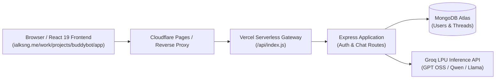

<div align="center">

# 🤖 BuddyBOT
### Intelligent, High-Speed AI Chat Assistant Powered by Groq LPU & MERN

[](https://ialksng.me/work/projects/buddybot/app)
[](https://opensource.org/licenses/MIT)
[](https://nodejs.org/)
[](https://react.dev/)
[](https://www.mongodb.com/)
[](https://groq.com/)

**BuddyBOT** is a modern, responsive, full-stack AI conversation platform built with React 19, Node.js, Express, and MongoDB. Featuring ultra-low-latency LPU inference from Groq, rich mathematical formula rendering via KaTeX, syntax-highlighted code blocks, real-time response cancellation, robust multi-layer history persistence, and seamless Google OAuth & JWT authentication.

[**Explore Live Demo → https://ialksng.me/work/projects/buddybot/app**](https://ialksng.me/work/projects/buddybot/app)

</div>

---

## 📑 Table of Contents

- [Overview & Highlights](#-overview--highlights)
- [Key Features](#-key-features)
- [Tech Stack](#-tech-stack)
- [System Architecture](#-system-architecture)
- [Project Directory Structure](#-project-directory-structure)
- [Getting Started (Local Development)](#-getting-started-local-development)
  - [Prerequisites](#prerequisites)
  - [Step-by-Step Installation](#step-by-step-installation)
  - [Environment Configuration](#environment-configuration)
- [API Reference](#-api-reference)
- [Deployment](#-deployment)
  - [Vercel (Zero-Config Serverless)](#vercel-zero-config-serverless)
  - [Cloudflare Pages / Reverse Proxy](#cloudflare-pages--reverse-proxy)
- [Contributing & License](#-contributing--license)

---

## 🌟 Overview & Highlights

BuddyBOT provides a fluid, ChatGPT-class user experience powered by open-source foundation models running on Groq LPUs. It addresses real-world edge cases in full-stack AI applications:

- **Instant LPU Inference**: Near-instant token generation with automated fallback across a curated chain of state-of-the-art models.
- **Flawless Mathematical Formatting**: Native KaTeX rendering for complex formulas (fractions, matrices, exponents, boxed answers) with automatic LaTeX delimiter normalization.
- **Tokyo Night Code Blocks**: Dark, high-contrast syntax highlighting with one-click clipboard copying and browser spellcheck suppression.
- **Zero-Loss History Persistence**: Namespaced browser storage (`buddybot_*`) prevents session and history wiping when switching tabs on shared-domain environments (`ialksng.me`).
- **Interactive Control**: Real-time **Stop Generation** button that aborts in-flight network requests via `AbortController` and freezes client typing animations on demand.

---

## 🚀 Key Features

### ⚡ 1. Curated AI Model Selection & Fallback Chain
Switch between high-performance models directly from the top navigation bar:
- **GPT OSS 120B** (`openai/gpt-oss-120b`) — Flagship reasoning and complex coding model *(Default)*.
- **GPT OSS 20B** (`openai/gpt-oss-20b`) — Ultra-fast, low-latency conversational model.
- **Qwen 3.8 27B** (`qwen/qwen3.8-27b`) — Multilingual, balanced general-purpose model.
- **Allam 2 7B** (`allam-2-7b`) — Compact instruction-tuned model.
- **Llama 3.3 70B & 3.1 8B** — Meta's open foundation architectures.
- *Automatic Resilience*: If an active model experiences upstream rate limits or outages, requests seamlessly fall back down the model chain.

### 🛑 2. Real-Time Stop Generation
- Click the glowing red **Stop** button or the pill in the loader to halt generation instantly.
- Uses `AbortController` to abort in-flight fetch requests without leaving zombie processes on the server.
- Automatically halts the typewriter animation in the frontend and displays the message generated up to that moment.

### 📐 3. Mathematical Formula Rendering (KaTeX)
- Integrates `remark-math` and `rehype-katex` with official KaTeX stylesheets.
- Built-in normalizer converts standard LaTeX bracket blocks (`\[ ... \]`, `[ \boxed{...} ]`) to `$$ ... $$` and inline notations (`\( ... \)`) to `$ ... $`.
- Standalone equations are rendered in responsive, scrollable math cards centered on the screen.

### 💻 4. Syntax-Highlighted Code Blocks
- Highlighted with a customized **Tokyo Night Dark** theme.
- Distinguishes keywords, strings, variables, numbers, comments, shebangs (`#!/usr/bin/env python3`), and function names with high-contrast palette values.
- Built-in one-click **Copy to Clipboard** button with instant feedback (`Copied!`).
- Suppresses browser grammar/spellcheck squiggly lines via `spellCheck="false"` and `data-gramm="false"`.

### 💾 5. Multi-Layer Session & Chat History Persistence
- **Hydration on Mount**: Active conversation (`buddybot_active_thread_chats`), selected thread (`buddybot_active_thread_id`), and thread history (`buddybot_cached_threads`) load instantly on page load (`F5`) with zero screen flicker.
- **Cross-Tab Isolation**: Storage keys are namespaced specifically to `buddybot_*`, preventing any collision with the parent portfolio domain (`ialksng.me`).
- **Background Synchronization**: Listens to `visibilitychange` and window `focus` events to silently sync threads from MongoDB when returning from other tabs.
- **Auto-Select on Login**: Automatically retrieves all historical threads and renders the latest chat upon authentication.

### 🔒 6. Dual Authentication & Guest Mode
- **JWT Password Authentication**: Secure bcrypt password hashing with 7-day signed JWT tokens.
- **Google OAuth 2.0**: One-click Google sign-in with automatic account selector (`prompt: select_account`) and an intermediate token injector that survives reverse-proxy redirects.
- **Guest Trial & Thread Claiming**: Unauthenticated users can test 1 free message; upon signing up or logging in, their guest conversation is claimed and saved to their account.

### 📱 7. Mobile-First Responsive Design
- Off-canvas sidebar navigation drawer on screens $< 768\text{px}$ with smooth transitions, backdrop blur, and touch auto-close.
- Sticky, bottom-anchored input bar with auto-expanding text layout and mobile-optimized send/stop controls.

---

## 🛠️ Tech Stack

### Frontend
- **Framework**: [React 19](https://react.dev/) + [Vite](https://vitejs.dev/)
- **Routing**: [React Router DOM v7](https://reactrouter.com/)
- **Markdown & Math**: `react-markdown`, `remark-gfm`, `remark-math`, `rehype-katex`, `katex`
- **Syntax Highlighting**: `rehype-highlight`, `highlight.js` (Tokyo Night Dark)
- **UI Components & Icons**: [FontAwesome 6](https://fontawesome.com/), `react-spinners`
- **HTTP Client**: Native `fetch` with `AbortController` + `axios`

### Backend
- **Runtime**: [Node.js](https://nodejs.org/) (ES Modules)
- **Framework**: [Express.js](https://expressjs.com/)
- **Database**: [MongoDB](https://www.mongodb.com/) with [Mongoose](https://mongoosejs.com/) ODM
- **AI Inference Engine**: [Groq Cloud API](https://groq.com/) (OpenAI-compatible SDK/REST)
- **Authentication**: [Passport.js](https://www.passportjs.org/) (Google Strategy), `jsonwebtoken`, `bcryptjs`
- **Session & Security**: `express-session`, `cookie-parser`, `cors`
- **Mailer**: `nodemailer` (SMTP / Gmail App Passwords)

### Deployment & Infrastructure
- **Serverless API & Hosting**: [Vercel](https://vercel.com/) (functions in `/api`)
- **Reverse Proxy**: [Cloudflare Pages](https://pages.cloudflare.com/) (routing `ialksng.me/work/projects/buddybot/app`)

---

## 🏛️ System Architecture



---

## 📁 Project Directory Structure

```text
buddybot/
├── api/                          # Vercel serverless function entry
│   └── index.js                  # Exports Express app for Vercel
├── backend/                      # Node.js Express backend
│   ├── config/
│   │   └── passport.js           # Google OAuth 2.0 configuration
│   ├── controllers/
│   │   └── authController.js     # Signup, login, forgot-password logic
│   ├── models/
│   │   ├── Thread.js             # Mongoose schema for chat threads & messages
│   │   └── User.js               # Mongoose schema for user accounts & roles
│   ├── routes/
│   │   ├── auth.js               # Auth endpoints & Google OAuth callback
│   │   └── chat.js               # Chat completions, thread CRUD, thread claiming
│   ├── utils/
│   │   ├── groq.js               # Groq API client, model list, fallback chain
│   │   └── sendEmail.js          # Nodemailer transactional email helper
│   └── server.js                 # Express server configuration & DB bootstrap
├── frontend/                     # React 19 Vite SPA
│   ├── public/
│   ├── src/
│   │   ├── assets/               # Branding, logos, and icons
│   │   ├── pages/                # Login, Signup, Dashboard pages
│   │   ├── apiConfig.js          # Dynamic API endpoint & base URL resolver
│   │   ├── App.jsx               # Root provider, session lifecycle, routing
│   │   ├── AuthModal.jsx         # Guest-to-user conversion modal
│   │   ├── Chat.jsx              # Markdown, KaTeX & code block message renderer
│   │   ├── ChatWindow.jsx        # Navbar, model selector, chat input, stop button
│   │   ├── models.js             # Client-side model fallback registry
│   │   ├── MyContext.jsx         # React Context definition
│   │   ├── Sidebar.jsx           # Thread list, new chat trigger, delete action
│   │   └── storage.js            # Namespaced buddybot_* localStorage manager
│   ├── package.json
│   └── vite.config.js
├── .env.example                  # Template of required environment variables
├── package.json                  # Root monorepo build & run scripts
├── vercel.json                   # Rewrites, route redirects, serverless settings
└── README.md
```

---

## 💻 Getting Started (Local Development)

### Prerequisites
- **Node.js**: v18.0.0 or higher
- **npm** or **yarn** / **pnpm**
- **MongoDB**: A free MongoDB Atlas cluster connection string or local MongoDB instance
- **Groq API Key**: Obtainable from [console.groq.com](https://console.groq.com/)

### Step-by-Step Installation

1. **Clone the repository:**
   ```bash
   git clone https://github.com/ialksng/buddybot.git
   cd buddybot
   ```

2. **Install all dependencies (root, backend, frontend):**
   ```bash
   npm run install:all
   ```

3. **Configure Environment Variables:**
   Copy `.env.example` to `.env` in the root directory:
   ```bash
   cp .env.example .env
   ```
   Fill in your configuration details (see [Environment Configuration](#environment-configuration) below).

4. **Run the Development Servers:**
   - **Start Backend:**
     ```bash
     npm run start
     ```
     The server will start at `http://localhost:3000`.

   - **Start Frontend (in a separate terminal):**
     ```bash
     cd frontend
     npm run dev
     ```
     The React application will launch at `http://localhost:5173`.

---

## 🔑 Environment Configuration

Create a `.env` file in the root directory with the following variables:

```ini
# ==========================================
# Database & AI Inference
# ==========================================
MONGODB_URI=mongodb+srv://<username>:<password>@cluster.mongodb.net/buddybot?retryWrites=true&w=majority
GROQ_API_KEY=gsk_your_groq_api_key_here
GROQ_MODEL=openai/gpt-oss-120b

# ==========================================
# Authentication & Security
# ==========================================
JWT_SECRET=your_super_secret_jwt_random_key
SESSION_SECRET=your_express_session_secret_key

# ==========================================
# Application URL
# ==========================================
# In local development:
CLIENT_URL=http://localhost:5173/work/projects/buddybot/app
# In production:
# CLIENT_URL=https://ialksng.me/work/projects/buddybot/app

# ==========================================
# Google OAuth 2.0 (Optional)
# ==========================================
GOOGLE_CLIENT_ID=your_google_client_id.apps.googleusercontent.com
GOOGLE_CLIENT_SECRET=your_google_client_secret
GOOGLE_CALLBACK_URL=https://ialksng.me/work/projects/buddybot/app/api/auth/google/callback

# ==========================================
# Email Service (Optional, for Password Reset)
# ==========================================
EMAIL_USER=your_gmail_address@gmail.com
EMAIL_PASS=your_16_digit_gmail_app_password
EMAIL_FROM="BuddyBOT <no-reply@ialksng.me>"
```

---

## 📡 API Reference

### Chat & Inference Endpoints

| Method | Endpoint | Description | Auth Required |
|---|---|---|:---:|
| `POST` | `/api/chat` | Send a user message and receive AI response | Optional (Guest/User) |
| `GET` | `/api/models` | List curated Groq models with metadata | No |
| `GET` | `/api/thread` | Retrieve all conversation threads for logged-in user | Yes (JWT) |
| `GET` | `/api/thread/:threadId` | Fetch all messages for a specific conversation | Optional |
| `DELETE` | `/api/thread/:threadId` | Delete a conversation thread permanently | Yes (JWT) |
| `POST` | `/api/claim-thread` | Claim and link a guest session thread to logged-in user | Yes (JWT) |

### Authentication Endpoints

| Method | Endpoint | Description |
|---|---|---|
| `POST` | `/api/auth/signup` | Register a new user with username, email, and password |
| `POST` | `/api/auth/login` | Authenticate with email and password; returns JWT token |
| `GET` | `/api/auth/me` | Verify active session and return user profile details |
| `GET` | `/api/auth/google` | Initiate Google OAuth 2.0 login flow |
| `GET` | `/api/auth/google/callback` | Google OAuth callback; injects token and redirects |
| `POST` | `/api/auth/forgot-password` | Send password recovery email via SMTP |

---

## ☁️ Deployment

### Vercel (Zero-Config Serverless)

BuddyBOT is configured to deploy directly to Vercel without complex manual configuration:
1. Import your GitHub repository into [Vercel](https://vercel.com).
2. Set the Root Directory to `./`.
3. Add the environment variables from your `.env` file into the Vercel Project Settings.
4. Click **Deploy**. Vercel will execute `npm run build`, bundle the Vite frontend into `frontend/dist`, and mount the Express API as a serverless function via `api/index.js`.

### Cloudflare Pages / Reverse Proxy

If hosting under a subpath like `https://yourdomain.com/work/projects/buddybot/app`, deploy a reverse proxy worker (such as Cloudflare Pages Functions) that forwards requests to your Vercel URL while rewriting `Location` headers for OAuth redirects.

---

## 📄 License

This project is licensed under the **MIT License** — see the [LICENSE](LICENSE) file for complete details.

```
MIT License
Copyright (c) 2025 - 2026 Alok Singh (ialksng)
```

---

## 👨‍💻 Author

Crafted with care by **Alok Singh ([@ialksng](https://github.com/ialksng))**  
Website: [https://ialksng.me](https://ialksng.me)  
LinkedIn: [linkedin.com/in/ialksng](https://linkedin.com/in/ialksng)

<div align="center">
  <sub>BuddyBOT — Built for speed, clarity, and intelligence.</sub>
</div>
